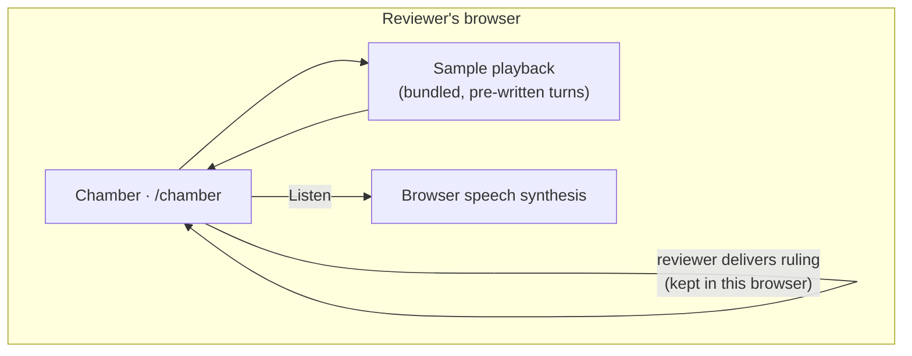

<div align="center">

# 
 Juro

### Both sides heard. One ruling.

An adversarial AI tribunal for denied health-insurance claims. Four agents argue a denial in one shared room on **Band**, a human delivers the ruling, and the turns of a recorded hearing are hash-chained so edits to them are detectable.

[**Live demo →**](https://juro-roan.vercel.app) · [**The Chamber →**](https://juro-roan.vercel.app/chamber) · [**Yt Explained →**](https://www.youtube.com/watch?v=N3ys8yAu0Vw)

Winner @ [**Hackdays**](https://hackdays-prayagraj.devpost.com/project-gallery) . [**Impact Creation**](https://impact-creation.devpost.com/project-gallery) . [**Measure Up**](https://measureme-up.devpost.com/project-gallery) . [**Build the Future with AI — From Code to No-Code**](https://build-the-future-with-ai.devpost.com/project-gallery)

</div>

---

## The problem

In the US, about **one in five** in-network health claims is denied, and **fewer than one in a hundred** is ever appealed. It isn't only here: roughly one in nine health claims is rejected in India, and two thirds of UK disability denials are overturned once a judge actually looks. The denials usually don't win because the law is against the patient. They win because nobody builds the case.

Juro builds it.

## What it does

When a claim is denied, four specialized agents take it to a tribunal in one shared room:

| Agent | Role |
|---|---|
| **Advocate** | Argues for the patient, marshalling the records and policy language that support coverage. |
| **Scrutinizer** | Argues the insurer's side, probing for missing documentation, exclusions, and step-therapy gaps. |
| **Evidence** | Stays neutral and produces the exact document or statute that settles a disputed fact. |
| **Adjudicator** | Chairs the hearing and recommends a ruling, then hands the decision to a human. |

They read and rebut each other instead of passing tasks down a line. A person reads the whole debate and delivers the decision. The AI argues. A human rules.

> **No paid services.** Anthropic and Deepgram are switched off in code (`web/src/lib/providers.ts`), even if API keys are present. By default the Chamber replays **pre-written sample hearings**, clearly labelled as samples, and reads them aloud with the browser's built-in speech. An optional **live hearing** runs on **Groq's free tier** only (a dedicated Free-plan account with no payment method); when its quota runs out the hearing pauses, with no paid fallback. See [`web/README.md`](web/README.md). The Python/Band path is held to the same rule: its Anthropic calls are blocked in code (`backend/src/juro/providers.py`), so `python -m juro.generate` and the Band agent processes refuse to run until a free model provider is wired in.

## Architecture

Two paths produce the same thing, a **transcript**, and the front end plays it. The Chamber plays a sample hearing; the Band runtime runs the four roles as separate agents in one shared room.

### The Chamber (what the demo shows)



By default nothing leaves the browser: there is no hearing API call, no database and no AI model. That is what a static or serverless host (such as Vercel) serves.

**Live hearings (Groq Free, opt-in).** The browser drives the debate one step at a time through a stateless `POST /api/live/step`; the server holds the Groq key, checks the turn order, uses only the bundled synthetic case, and makes one free-tier call per step. No database or worker, so it also runs on Vercel. Nothing is stored or sealed.

**Durable hearings (local, opt-in).** With `NEXT_PUBLIC_DURABLE_HEARINGS=1` on a long-running Node server, hearings run server-side, are stored in SQLite, survive closing the tab and server restarts, and can be paused/resumed. They still replay the sample record (no paid generation). See [`web/README.md`](web/README.md).

### The Band tribunal (the multi-agent runtime)


Each agent is its own process that connects to Band over a WebSocket and joins one shared room. They argue by `@mentioning` each other, which is the part that needs Band: real multi-agent coordination, not a hub handing out work.

## What makes it hold up

Getting four independent models to run a clean debate was the hard part. On the Band path:

- **A cross-model panel (Band path).** The three debaters run on a fast model (`claude-haiku-4-5`); the chair runs on a heavier one (`claude-sonnet-4-6`). The web Chamber does not call these models; it replays samples.
- **A deterministic relay.** A mention-driven debate stalls when a model hands off to the wrong agent, and goes silent when a model returns its ruling as plain text without posting. Juro's custom LangGraph adapter forces every handoff in code and posts the model's final text itself if the send tool was skipped.
- **A hash-chained transcript (durable hearings and Band exports).** Each stored turn's hash covers the previous hash, so editing a stored turn breaks the chain. Limits today: the chain covers turns only (not the recommendation or ruling), there is no published checkpoint, and anyone who can rewrite the database can recompute it. Browser sample playback is not hashed or sealed.
- **Rulings are not identity-verified.** A durable hearing's controls (pause, resume, ruling) need a token held by the browser that started it. The token authorizes the action; it does not establish who the reviewer is.

## Tech stack

| Layer | What |
|---|---|
| Front end | Next.js 16 (App Router), React 19, Tailwind v4, Motion, Lenis |
| Durable hearings (local, opt-in) | SQLite via `better-sqlite3`, in-process worker |
| Live hearings (opt-in) | Groq free tier (`openai/gpt-oss-20b` debaters, `openai/gpt-oss-120b` chair by default) |
| Voice | Browser speech synthesis (Web Speech API) |
| Agents (Band path; model calls disabled) | Python, `band-sdk` (Band), LangGraph; Anthropic Claude calls are blocked (no paid services) |
| Deploy | Static/serverless host for sample playback (e.g. Vercel); durable hearings need a long-running Node server |

## Repository

```
web/                      Next.js app — the landing and the Chamber
  src/app/
    page.tsx              the landing ("Court Record")
    chamber/page.tsx      the reviewer console (sample playback by default)
    chamber/[id]/page.tsx reopen a durable hearing by link (opt-in)
    api/hearings/...      durable hearing API (opt-in; off by default)
    api/speak/route.ts    server TTS (disabled: no paid services)
  src/components/         Chamber, HearingTranscript, landing, motion
  src/lib/                transcript schema, sample playback, durable-hearing hooks, roles, voice, provider controls
  src/lib/hearings/       durable hearing store (SQLite), runner, scheduler, tests
  src/data/               the bundled sample cases

backend/                  Python
  src/juro/
    roles.py              the four role prompts + the Band relay protocol
    agents/               the Band agent processes (advocate, scrutinizer, …)
    band_runner.py        register agents, submit a case, export the transcript
    band_api.py           thin async wrappers over Band's REST API
    generate.py           run the debate locally (Anthropic only)
    transcript.py         the transcript model + the hash chain
```

## Getting started

### The web app

```bash
cd web
npm install
npm run dev          # http://localhost:3000
```

No keys are needed or used. The landing page and the Chamber run from the bundled sample cases; **Listen** uses the browser's own voices. Setting `ANTHROPIC_API_KEY` or `DEEPGRAM_API_KEY` does not enable anything: paid providers are off in code.

To try durable server-side hearings locally, add `NEXT_PUBLIC_DURABLE_HEARINGS=1` to `web/.env.local` and restart (details in [`web/README.md`](web/README.md)).

### The Band tribunal

```bash
cd backend
pip install -e .

# the Band SDK pins a private submodule, so install it from a no-submodule clone:
git clone --depth 1 https://github.com/thenvoi/thenvoi-sdk-python.git /tmp/band-sdk
pip install "/tmp/band-sdk[langgraph,anthropic]"

# put your Band user key + Anthropic key in backend/.env, then:
python -m juro.band_runner setup          # register the four agents on Band
python -m juro.agents.advocate            # start each agent (own process); they
python -m juro.agents.scrutinizer         #   connect over WebSocket and wait to
python -m juro.agents.evidence            #   be @mentioned
python -m juro.agents.adjudicator
python -m juro.band_runner brief mri-erisa  # print a case brief to paste into a room
```

Create a room in the Band web app, add the four agents, paste the brief, and `@mention` the Adjudicator. The agents argue; you reply `OVERTURN` or `UPHOLD`.

## Grounded in real law

Every ruling cites its authority. The cases are built on real statute: ERISA's full-and-fair-review right (`29 C.F.R. § 2560.503-1`), the ACA's binding external review (`45 C.F.R. § 147.136`), *Jimmo v. Sebelius*, the ACR Appropriateness Criteria, and the No Surprises Act.

## License

MIT. See [LICENSE](LICENSE).
