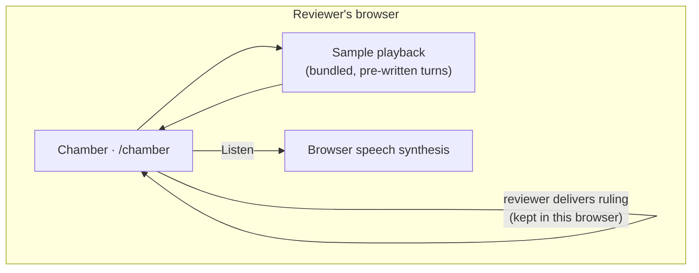
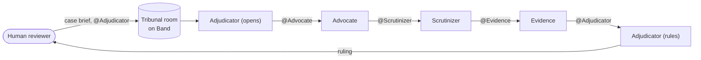

<div align="center">

# 
 Juro

### Both sides heard. One ruling.

An adversarial AI tribunal for denied health-insurance claims. Four agents argue a denial in one shared room on **Band**, a human delivers the ruling, and the turns of a recorded hearing are hash-chained so edits to them are detectable.

[**Live demo →**](https://juro-eta.vercel.app) · [**The Chamber →**](https://juro-eta.vercel.app/chamber) · [**Yt Explained →**](https://www.youtube.com/watch?v=N3ys8yAu0Vw)

Winner @ [**Hackdays**](https://hackdays-prayagraj.devpost.com/project-gallery) . [**Impact Creation**](https://impact-creation.devpost.com/project-gallery) . [**Measure Up**](https://measureme-up.devpost.com/project-gallery) . [**Build the Future with AI — From Code to No-Code**](https://build-the-future-with-ai.devpost.com/project-gallery)

</div>

---

## The problem

In the US, about **one in five** in-network health claims is denied, and **fewer than one in a hundred** is ever appealed. It isn't only here: roughly one in nine health claims is rejected in India, and two thirds of UK disability denials are overturned once a judge actually looks. The denials usually don't win because the law is against the patient. They win because nobody builds the case.

Juro builds it.

## What it does

When a claim is denied, four specialized agents take it to a tribunal in one shared room:

| Agent | Role |
|---|---|
| **Advocate** | Argues for the patient, marshalling the records and policy language that support coverage. |
| **Scrutinizer** | Argues the insurer's side, probing for missing documentation, exclusions, and step-therapy gaps. |
| **Evidence** | Stays neutral and produces the exact document or statute that settles a disputed fact. |
| **Adjudicator** | Chairs the hearing and recommends a ruling, then hands the decision to a human. |

They read and rebut each other instead of passing tasks down a line. A person reads the whole debate and delivers the decision. The AI argues. A human rules.

> **No paid services.** Anthropic and Deepgram are switched off in code (`web/src/lib/providers.ts`), even if API keys are present. By default the Chamber replays **pre-written sample hearings**, clearly labelled as samples, and reads them aloud with the browser's built-in speech. An optional **live hearing** runs on **Groq's free tier** only (a dedicated Free-plan account with no payment method); when its quota runs out the hearing pauses, with no paid fallback. See [`web/README.md`](web/README.md). The Python side follows the same rule (`backend/src/juro/providers.py`): the Band agents run on **Groq's free tier** with the same three opt-in switches, and `python -m juro.generate` stays blocked because it calls Anthropic.

## Architecture

Two paths produce the same thing, a **transcript**, and the front end plays it. The Chamber plays a sample hearing; the Band runtime runs the four roles as separate agents in one shared room.

### The Chamber (what the demo shows)



By default nothing leaves the browser: there is no hearing API call, no database and no AI model. That is what a static or serverless host (such as Vercel) serves.

**Live hearings (Groq Free, invited preview).** A tester code opens a one-hour session. The browser drives the debate through `POST /api/live/step` using server-signed continuations, never editable transcript text. The server binds the synthetic case, model and instructions to the session. Four roles use one model. No database or worker is needed; leaving or reloading ends the hearing. Duplicate suppression and admission limits are per instance, not global: keep access restricted until a shared quota/replay store is available. Signed continuations establish input provenance, not a sealed audit record or reviewer identity. See [`web/README.md`](web/README.md).

**Durable hearings (local, opt-in).** With `NEXT_PUBLIC_DURABLE_HEARINGS=1` on a long-running Node server, hearings run server-side, are stored in SQLite, survive closing the tab and server restarts, and can be paused/resumed. They still replay the sample record (no paid generation). See [`web/README.md`](web/README.md).

### The Band tribunal (the multi-agent runtime)



Each agent is its own process that connects to Band over a WebSocket and joins one shared room. They argue by `@mentioning` each other, which is the part that needs Band: real multi-agent coordination, not a hub handing out work. All four agents run on one Groq free-tier model.

If Groq's free quota runs out mid-hearing, the agent whose turn it is posts a `[tribunal notice]` to the reviewer and the tribunal stops; there is no paid fallback. Per-minute limits are waited out (up to two retries). When the quota resets, `@mention` that agent to resume from the same step: the Adjudicator remembers per room whether it has opened, so a resume never restarts the debate. (That memory lives in the Adjudicator process; restarting it mid-hearing forgets it, though a message from Evidence still triggers the ruling.)

## What makes it hold up

Getting four independent models to run a clean debate was the hard part. On the Band path:

- **A deterministic relay.** A mention-driven debate stalls when a model hands off to the wrong agent, and goes silent when a model returns its ruling as plain text without posting. Juro's custom LangGraph adapter forces every handoff in code and posts the model's final text itself if the send tool was skipped.
- **Never silent, never paid.** A rate limit is waited out, a used-up free quota pauses with a notice to the reviewer, and any other failure posts a notice instead of leaving the room hanging. A failure after an agent has already posted is not retried, so turns are never duplicated.
- **A hash-chained transcript (durable hearings and Band exports).** Each stored turn's hash covers the previous hash, so editing a stored turn breaks the chain. Limits today: the chain covers turns only (not the recommendation or ruling), there is no published checkpoint, and anyone who can rewrite the database can recompute it. Browser sample playback is not hashed or sealed.
- **Rulings are not identity-verified.** A durable hearing's controls (pause, resume, ruling) need a token held by the browser that started it. The token authorizes the action; it does not establish who the reviewer is.

## Tech stack

| Layer | What |
|---|---|
| Front end | Next.js 16 (App Router), React 19, Tailwind v4, Motion, Lenis |
| Durable hearings (local, opt-in) | SQLite via `better-sqlite3`, in-process worker |
| Live hearings (invited preview) | Groq Free account; one `openai/gpt-oss-20b` model for all roles by default |
| Voice | Browser speech synthesis (Web Speech API) |
| Agents (Band path) | Python, `band-sdk` (Band), LangGraph, `langchain-groq` on Groq's free tier (one model for all four roles) |
| Deploy | Static/serverless host for sample playback (e.g. Vercel); durable hearings need a long-running Node server |

## Repository

```
web/                      Next.js app — the landing and the Chamber
  src/app/
    page.tsx              the landing ("Court Record")
    chamber/page.tsx      the reviewer console (sample playback by default)
    chamber/[id]/page.tsx reopen a durable hearing by link (opt-in)
    api/hearings/...      durable hearing API (opt-in; off by default)
    api/speak/route.ts    server TTS (disabled: no paid services)
  src/components/         Chamber, HearingTranscript, landing, motion
  src/lib/                transcript schema, sample playback, durable-hearing hooks, roles, voice, provider controls
  src/lib/hearings/       durable hearing store (SQLite), runner, scheduler, tests
  src/data/               the bundled sample cases

backend/                  Python
  src/juro/
    roles.py              the four role prompts + the Band relay protocol
    agents/               the Band agent processes (advocate, scrutinizer, …)
    llm.py                the agents' Groq free-tier model (provider re-checked per call)
    relay.py              rate-limit waits, quota pauses, failure notices, chair phases
    providers.py          provider controls (Anthropic blocked, Groq Free opt-in)
    band_runner.py        register agents, submit a case, export the transcript
    band_api.py           thin async wrappers over Band's REST API
    generate.py           local generator (blocked: calls Anthropic)
    transcript.py         the transcript model + the hash chain
```

## Getting started

### The web app

```bash
cd web
npm install
npm run dev          # http://localhost:3000
```

No keys are needed or used. The landing page and the Chamber run from the bundled sample cases; **Listen** uses the browser's own voices. Setting `ANTHROPIC_API_KEY` or `DEEPGRAM_API_KEY` does not enable anything: paid providers are off in code.

To try durable server-side hearings locally, add `NEXT_PUBLIC_DURABLE_HEARINGS=1` to `web/.env.local` and restart (details in [`web/README.md`](web/README.md)).

### The Band tribunal

```bash
cd backend
pip install -e .

# the Band SDK pins a private submodule, so install it from a no-submodule clone:
git clone --depth 1 https://github.com/thenvoi/thenvoi-sdk-python.git /tmp/band-sdk
pip install "/tmp/band-sdk[langgraph]" langchain-groq

# copy backend/.env.example to backend/.env and fill in your Band user key plus, from a
# dedicated Groq FREE-plan account with no payment method: JURO_LIVE_PROVIDER=groq,
# GROQ_API_KEY=..., JURO_GROQ_FREE_CONFIRMED=1. Then:
python -m juro.band_runner setup          # register the four agents on Band
python -m juro.agents.advocate            # start each agent (own process); they
python -m juro.agents.scrutinizer         #   connect over WebSocket and wait to
python -m juro.agents.evidence            #   be @mentioned
python -m juro.agents.adjudicator
python -m juro.band_runner brief mri-erisa  # print a case brief to paste into a room
```

Create a room in the Band web app, add the four agents, paste the brief, and `@mention` the Adjudicator. The agents argue; after the Adjudicator's ruling, reply starting with `OVERTURN`, `UPHOLD` or `REMAND`. Then `python -m juro.band_runner export` writes the transcript; it reads the case from the claim id in your brief and refuses to export a hearing without a ruling and your decision.

Before the first full hearing, run `python -m juro.groq_check`. It makes at most three capped calls on a synthetic case (no retries, stops at the first rate limit) and reports whether the model calls the send tool with valid arguments, token use, latency and your remaining limits. If it warns, set `GROQ_MODEL` to another Free-plan model.

The Adjudicator's opening, every handoff line and the ruling's closing line are written by code; the models write only the arguments.

After a hearing, `python -m juro.telemetry summary` shows what it cost: per-turn input/output tokens (and how many calls didn't report usage), retries, time spent waiting on rate limits, model time, the hearing's wall-clock duration (earliest start to latest end across all four agents), and the peak observed tokens in any 60-second window. That peak is an observation to compare with your tokens-per-minute limit, not Groq's own quota accounting, and calls that didn't report usage aren't counted, so it can understate. The log is local (`backend/.telemetry/`, gitignored) and holds counts and timings only, never message text or keys. Several hearings in the same room are kept apart as runs (each opening starts one); the summary shows the latest run, `--run N` picks another, `--all` shows every run, and `python -m juro.telemetry list` lists rooms. Malformed or cut-off log lines are skipped and counted, and turns that never finished are flagged.

**Cleaning up telemetry:** it is never deleted automatically. Remove one room's folder under `backend/.telemetry/`, or the whole `backend/.telemetry/` folder; nothing else depends on it.

### Checks

```bash
python scripts/verify.py          # everything: case data, provider guards, sample-only, backend + web tests, lint, types, build
```

Cases live in one file, `data/cases.json`. After editing it, run `python scripts/sync_cases.py` to validate it and regenerate the copies the web app and backend read.

## Grounded in real law

Every ruling cites its authority. The cases are built on real statute: ERISA's full-and-fair-review right (`29 C.F.R. § 2560.503-1`), the ACA's binding external review (`45 C.F.R. § 147.136`), *Jimmo v. Sebelius*, the ACR Appropriateness Criteria, and the No Surprises Act.

## License

MIT. See [LICENSE](LICENSE).
